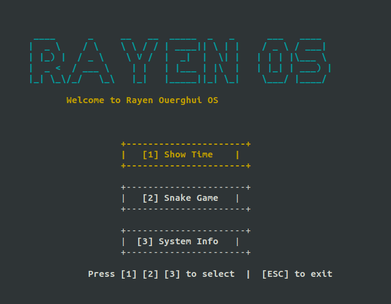
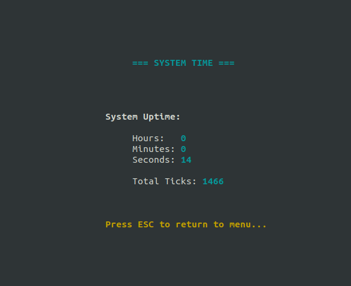
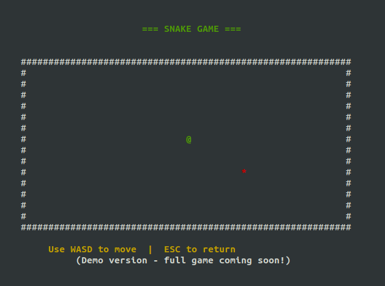
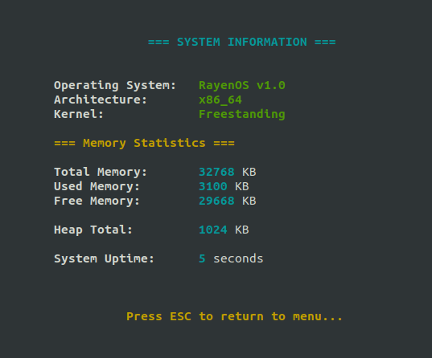

# RayenOS / WatchOS

A custom bare-metal operating system built for the x86_64 architecture by **Mohamed Rayen Ouerghui**. WatchOS boots directly through GRUB, runs in 64-bit mode, and includes its own kernel, hardware drivers, memory management, multitasking, and interactive VGA interface.

This project is an independent systems programming experiment written primarily in C and x86_64 assembly. It does not depend on an existing operating system or a standard C library.

## Screenshots

### Home Screen

<p align="center">
  
</p>

### System Time

<p align="center">
  
</p>

### Snake Game

<p align="center">
  
</p>

### System Information

<p align="center">
  
</p>

## Features

- Multiboot2-compatible x86_64 kernel
- VGA text-mode interface with a custom menu and ASCII logo
- PIT timer and programmable interrupt controller support
- Keyboard input through hardware IRQs
- CPU exception and interrupt handling
- Physical memory manager and 4-level paging
- Dynamic heap allocator with block coalescing
- Process control blocks and round-robin scheduling
- Context switching in assembly
- System uptime and memory statistics
- Interactive Snake demo

## User Interface

The main menu provides three applications:

| Key | Application | Description |
|:---:|-------------|-------------|
| `1` | System Time | Displays uptime, hours, minutes, seconds, and timer ticks |
| `2` | Snake | Opens the VGA-based Snake game demo |
| `3` | System Information | Shows architecture, memory usage, heap usage, and uptime |
| `ESC` | Back | Returns to the main menu |

## Technology

- **Language:** C and GNU x86_64 assembly
- **Architecture:** x86_64
- **Bootloader:** GRUB with Multiboot2
- **Display:** Direct VGA memory access at `0xB8000`
- **Build tools:** GCC, GNU assembler, LD, and Make
- **Virtual machine:** QEMU

## Core Components

| Component | Responsibility |
|-----------|----------------|
| `entry.S` | Kernel entry point and stack setup |
| `idt.c` / `exceptions.S` | Interrupt descriptor table and CPU exception handling |
| `pic.c` / `irq.S` | Hardware interrupt routing |
| `timer.c` / `keyboard.c` | PIT timer and keyboard drivers |
| `pmm.c` / `paging.c` | Physical memory allocation and virtual memory |
| `heap.c` | Dynamic kernel memory allocation |
| `process.c` / `scheduler.c` | Process management and round-robin scheduling |
| `context_switch.S` | Saving and restoring CPU context |
| `ui.c` / `vga.c` | Interactive interface and text-mode rendering |

## Project Structure

```text
WatchOS-Bare-Metal/
├── boot/
│   └── grub.cfg
├── kernel/
│   ├── entry.S
│   ├── kernel.c
│   ├── linker.ld
│   ├── ui.c
│   ├── vga.c
│   ├── timer.c
│   ├── keyboard.c
│   ├── pmm.c
│   ├── paging.c
│   ├── heap.c
│   ├── process.c
│   └── scheduler.c
├── build.sh
├── makefile
├── ARCHITECTURE.md
└── readme.md
```

## Building

Install the required Linux tools:

```bash
sudo apt update
sudo apt install -y build-essential grub-pc-bin grub-common xorriso qemu-system-x86
```

Build the ISO:

```bash
make clean
make all
```

Run WatchOS in QEMU:

```bash
make run-gui
```

Other Make targets:

```bash
make run      # Run with the terminal/curses display
make debug    # Run with QEMU CPU debugging enabled
make clean    # Remove generated build files
```

A complete build can also be started with:

```bash
./build.sh
```

## Debugging

The debug target enables QEMU CPU logging:

```bash
make debug
```

Useful binary inspection commands:

```bash
file build/kernel.bin
objdump -h build/kernel.bin
nm build/kernel.bin | grep -E "kernel_main|_start|heap"
objdump -d build/kernel.bin
```

## Author

**Mohamed Rayen Ouerghui**  
IT Engineering Student — Low-Level Systems and Operating System Development

